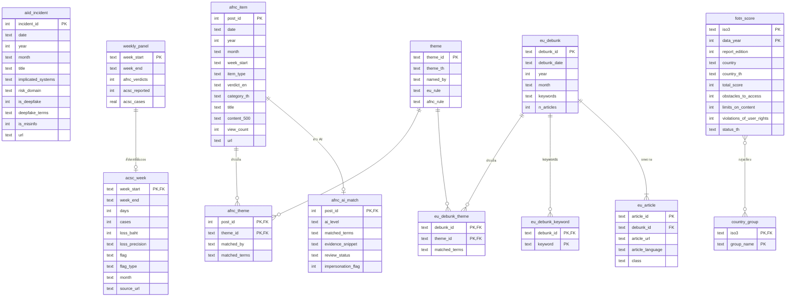

# 03 — โครงสร้างฐานข้อมูล SQL และค่าคาดหวัง (Adidur — จริงหรือเฟค)

- **ฐานข้อมูล:** SQLite ไฟล์ `data/adidur.db`
- **สร้างด้วย:** `python build_db.py data/raw data/adidur.db`
- **ปี:** ทุกคอลัมน์ปีและวันที่เก็บเป็น **ค.ศ.** ตามต้นทาง แปลงเป็น พ.ศ. (+543) ที่ชั้นแสดงผลเท่านั้น
- **ชื่อที่ตั้งเอง:** ชื่อตารางและคอลัมน์ที่ขึ้นต้นด้วย `is_`, `flag_type`, `ai_level`, `theme*`, `country_group`, `country_th` เป็นชื่อที่ตั้งเอง

## 1. ER diagram



**ข้อมูลที่ไม่มีความสัมพันธ์ระดับแถวข้ามชุด**

- AIID ↔ AFNC ↔ ACSC ↔ EUvsDisinfo ↔ FOTN เชื่อมกันได้ด้วย **เวลา** (ปีหรือเดือน) และ **ประเด็น** (ผ่านตาราง theme) เท่านั้น
- ไม่มีคีย์ข่าวต่อข่าวหรือคดีต่อข่าว
- ACSC ไม่ถูกกรองด้วยตัวกรองข่าว AI หรือหมวด AFNC

## 2. ตาราง

| ตาราง | 1 แถว = | แถว | คีย์ | ที่มา |
|---|---|---|---|---|
| aiid_incident | เหตุการณ์ AI | 1,775 | incident_id | AIID ชีต Incidents |
| afnc_item | โพสต์ AFNC | 17,726 | post_id | ชีต afnc_items (content ตัด 500 ตัวอักษร) |
| afnc_ai_match | ข่าวเท็จที่เข้าเกณฑ์ AI | 56 | post_id | คำนวณ (02 ข้อ 4.1) |
| acsc_week | การแถลง 1 สัปดาห์ | 48 | week_start | ชีต acsc_weekly + flag_type, month |
| weekly_panel | สัปดาห์ปฏิทิน | 409 | week_start | ชีต weekly_panel |
| eu_article | บทความ | 18,249 | article_id | euvsdisinfo_base.csv |
| eu_debunk | การหักล้าง | 8,522 | debunk_id | สรุปจาก eu_article |
| eu_debunk_keyword | การหักล้าง × keyword | 29,842 | (debunk_id, keyword) | แยก keywords |
| theme | ประเด็น (ตั้งเอง) | 7 | theme_id | พจนานุกรม 02 ข้อ 7 |
| eu_debunk_theme / afnc_theme | เรื่อง × ประเด็น | 8,814 / 10,280 | (id, theme_id) | คำนวณ |
| fotn_score | ประเทศ × ปีข้อมูล | 940 | (iso3, data_year) | freedom_on_the_net_scores.csv |
| country_group | ประเทศ × กลุ่มเทียบ | 9 | (iso3, group_name) | ตั้งเอง: ASEAN 8 ประเทศ + RUS (เปรียบเทียบเพิ่ม) |
| thai_data_dictionary | คอลัมน์ | 30 | | ชีต data_dictionary สำหรับแท็บ 4 |

## 3. SQL ต่อ KPI และกราฟ

**พารามิเตอร์จาก state ของแท็บ**

| พารามิเตอร์ | ความหมาย |
|---|---|
| `:y0`, `:y1` | ช่วงปี ค.ศ. |
| `:year` | ปีที่ drill ลงไป |
| `:month` | `YYYY-MM` |
| `:levels` | รายการ ai_level |
| `:category` | category_th |
| `:imp` | 0/1/NULL |
| `:theme` | theme_id |
| `:fy` | data_year ของ FOTN |
| `:iso3` | ประเทศ |
| `:inc_suspect` | 0/1 |

ถ้าพารามิเตอร์ใดเป็น NULL ให้ถือว่าไม่กรอง

พารามิเตอร์แบบรายการ (`:levels`, `:groups`) SQLite bind เป็นรายการตรง ๆ ไม่ได้ ให้สร้าง placeholder ตามจำนวนค่าในโค้ด เช่น `IN (?,?)`

**ระดับเวลา (drill)**

| ระดับ | grain | ช่วงข้อมูล |
|---|---|---|
| L0 | ปี | `:y0..:y1` |
| L1 | เดือน | `WHERE year=:year` |
| L2 | รายการ | `WHERE month=:month` |

### แท็บ 1 — AI และภัยออนไลน์ในไทย

```sql
-- K1.1 เหตุการณ์ Deepfake (AIID) หน่วย: เหตุการณ์
SELECT COUNT(DISTINCT incident_id) FROM aiid_incident
WHERE is_deepfake=1 AND year BETWEEN :y0 AND :y1
  AND (:year IS NULL OR year=:year) AND (:month IS NULL OR month=:month);

-- K1.2 ข่าวเท็จที่เกี่ยวกับ AI (AFNC) หน่วย: โพสต์
SELECT COUNT(DISTINCT a.post_id) FROM afnc_ai_match m JOIN afnc_item a USING(post_id)
WHERE a.year BETWEEN :y0 AND :y1 AND (:year IS NULL OR a.year=:year) AND (:month IS NULL OR a.month=:month)
  AND m.ai_level IN (:levels) AND (:category IS NULL OR a.category_th=:category)
  AND (:imp IS NULL OR m.impersonation_flag=:imp);

-- K1.3 / K1.4 คดีและความเสียหาย (ACSC) หน่วย: คดี / บาท / บาทต่อคดี
--   ไม่รับ :levels :category :imp (ไม่มีตัวเชื่อม)
--   ช่วงเวลาที่ใช้ = จุดตัดของช่วงที่เลือกกับช่วงที่ ACSC มีข้อมูล ถ้าไม่ตัดกันให้แสดง "ไม่มีข้อมูล ACSC ในช่วงที่เลือก"
SELECT COUNT(*) AS weeks, SUM(cases) AS cases, SUM(loss_baht) AS loss_baht,
       1.0*SUM(loss_baht)/SUM(cases) AS loss_per_case            -- ห้ามใช้ AVG(loss_per_case_baht)
FROM acsc_week
WHERE cases IS NOT NULL AND loss_baht IS NOT NULL
  AND CAST(substr(week_start,1,4) AS INT) BETWEEN :y0 AND :y1
  AND (:year IS NULL OR substr(week_start,1,4)=CAST(:year AS TEXT))
  AND (:month IS NULL OR month=:month)
  AND (:inc_suspect=1 OR COALESCE(flag_type,'')<>'suspect');
-- ข้อความผลต่อยอดรวม = ผลของ :inc_suspect=1 ลบด้วยผลของ :inc_suspect=0

-- C1.1 เส้นบน: Deepfake ตามเวลา (L0 รายปี / L1 รายเดือน)
SELECT year AS t, COUNT(*) AS n FROM aiid_incident
WHERE is_deepfake=1 AND year BETWEEN :y0 AND :y1 GROUP BY year ORDER BY year;
SELECT month AS t, COUNT(*) AS n FROM aiid_incident
WHERE is_deepfake=1 AND year=:year GROUP BY month ORDER BY month;

-- C1.2 เส้นล่าง: ข่าว AI ตามเวลา แยกระดับ (แกน x ร่วมกับ C1.1 ต้องเติมปีที่ไม่มีข่าวเป็น 0
--   เพราะ AFNC มีข้อมูลทุกปีตั้งแต่ 2562 แต่ก่อน 2562 ให้เป็นค่าว่าง)
SELECT a.year AS t, m.ai_level, COUNT(*) AS n FROM afnc_ai_match m JOIN afnc_item a USING(post_id)
WHERE a.year BETWEEN :y0 AND :y1 AND (:category IS NULL OR a.category_th=:category)
  AND (:imp IS NULL OR m.impersonation_flag=:imp)
GROUP BY a.year, m.ai_level;

-- C1.3 แท่งแนวนอน: หมวดของข่าว AI
SELECT a.category_th, COUNT(*) AS n FROM afnc_ai_match m JOIN afnc_item a USING(post_id)
WHERE a.year BETWEEN :y0 AND :y1 AND (:year IS NULL OR a.year=:year) AND (:month IS NULL OR a.month=:month)
  AND m.ai_level IN (:levels) AND (:imp IS NULL OR m.impersonation_flag=:imp)
GROUP BY a.category_th ORDER BY n DESC;

-- C1.4 การ์ดข่าวเด่น: อันดับ 1–3 ยอดเข้าชมสูงสุด + 1 รายการต่ำสุด ในชุดที่กรองอยู่
SELECT a.post_id, a.date, a.title, a.category_th, a.view_count, a.url, m.ai_level, m.evidence_snippet
FROM afnc_ai_match m JOIN afnc_item a USING(post_id)
WHERE <เงื่อนไขเดียวกับ K1.2>
ORDER BY a.view_count DESC, a.post_id ASC LIMIT 3;
-- ต่ำสุด: ORDER BY a.view_count ASC, a.post_id ASC LIMIT 1
--   ถ้าชุดมีน้อยกว่า 4 รายการ ไม่แสดงรายการซ้ำในการ์ดต่ำสุด ให้แสดง "มีข่าวในชุดนี้ N รายการ"

-- C1.5 แท่ง: คดีรายสัปดาห์ ใช้คอลัมน์ acsc_* ของ weekly_panel ซึ่งจัดลงปฏิทินอาทิตย์–เสาร์ไว้แล้ว
--   (สัปดาห์ 8 วันที่เริ่ม 30 พ.ค. 2569 ถูกวางไว้ที่สัปดาห์ 31 พ.ค. 2569 ใน weekly_panel)
--   ห้าม JOIN acsc_week ด้วย week_start ตรง ๆ เพราะสัปดาห์นั้นจะหลุด
--   สัปดาห์ที่ไม่มีแถลง = NULL (ช่องว่าง) และสัปดาห์น่าสงสัยเมื่อไม่รวม = NULL พร้อมป้าย "ไม่รวม (น่าสงสัย)"
SELECT w.week_start, w.week_end,
  CASE WHEN :inc_suspect=0 AND w.acsc_flag LIKE 'Suspect%' THEN NULL ELSE w.acsc_cases END AS cases,
  CASE WHEN :inc_suspect=0 AND w.acsc_flag LIKE 'Suspect%' THEN NULL ELSE w.acsc_loss_baht END AS loss_baht,
  w.acsc_loss_precision AS loss_precision,
  CASE WHEN w.acsc_flag IS NULL THEN NULL WHEN w.acsc_flag LIKE 'Suspect%' THEN 'suspect' ELSE 'note' END AS flag_type,
  w.acsc_reported, w.acsc_source_url AS source_url
FROM weekly_panel w
WHERE w.week_start >= '2025-11-09' AND (:month IS NULL OR substr(w.week_start,1,7)=:month)
ORDER BY w.week_start;
-- ผลที่ต้องได้: 51 สัปดาห์ (9 พ.ย. 2568 – 25 ต.ค. 2569), มีค่า 48, ว่าง 3 (เมื่อ :inc_suspect=1)
-- ระดับเดือน (drill up ของ ACSC): SUM ต่อ month จาก acsc_week โดยนับ month จาก week_start (ตั้งเอง)

-- C1.6 เส้น: ความเสียหายรายสัปดาห์ ใช้คอลัมน์ loss_baht, loss_precision จากคิวรี C1.5

-- T1 ตารางหลักฐาน: ข่าว AFNC + เหตุการณ์ AIID ในช่วงที่เลือก
SELECT 'AFNC' AS source, a.date, a.title, a.category_th AS category, m.matched_terms AS reason,
       m.evidence_snippet, m.review_status, a.url
FROM afnc_ai_match m JOIN afnc_item a USING(post_id) WHERE <เงื่อนไข K1.2>
UNION ALL
SELECT 'AIID', date, title, risk_domain, deepfake_terms, substr(description,1,160), NULL, url
FROM aiid_incident WHERE is_deepfake=1 AND <เงื่อนไขเวลา K1.1>
ORDER BY date DESC;
```

### แท็บ 2 — ประเด็นข้อมูลบิดเบือนต่างประเทศกับไทย

```sql
-- C2.1 Heatmap EUvsDisinfo: ปี × ประเด็น สัดส่วน % (ตัวหาร = การหักล้างทั้งหมดในปีนั้น)
WITH den AS (SELECT year, COUNT(*) n FROM eu_debunk WHERE year BETWEEN :y0 AND :y1 GROUP BY year)
SELECT d.year, t.theme_id, COUNT(DISTINCT t.debunk_id) AS n, 100.0*COUNT(DISTINCT t.debunk_id)/den.n AS pct
FROM eu_debunk_theme t JOIN eu_debunk d USING(debunk_id) JOIN den USING(year)
GROUP BY d.year, t.theme_id;

-- C2.2 Heatmap AFNC: ปี × ประเด็น สัดส่วน % (ตัวหาร = ข่าวเท็จ Fake+Distorted ทั้งหมดในปีนั้น)
WITH den AS (SELECT year, COUNT(*) n FROM afnc_item
             WHERE item_type='Verdict' AND verdict_en IN ('Fake','Distorted') AND year BETWEEN :y0 AND :y1
             GROUP BY year)
SELECT a.year, t.theme_id, COUNT(DISTINCT t.post_id) AS n, 100.0*COUNT(DISTINCT t.post_id)/den.n AS pct
FROM afnc_theme t JOIN afnc_item a USING(post_id) JOIN den USING(year)
GROUP BY a.year, t.theme_id;

-- C2.3 เส้นสัดส่วนของประเด็นที่เลือก (:theme) ทั้งสองแหล่ง = แถวของ C2.1 และ C2.2 ที่ theme_id=:theme

-- C2.4 แท่งซ้อน: ข่าวเท็จ AFNC ตามหมวด รายปี (L1 รายเดือนเมื่อ drill)
SELECT year, category_th, COUNT(*) AS n FROM afnc_item
WHERE item_type='Verdict' AND verdict_en IN ('Fake','Distorted') AND year BETWEEN :y0 AND :y1
GROUP BY year, category_th;

-- C2.5 แผงบริบท AIID Misinformation รายปี (หน่วย: เหตุการณ์ แกนแยก)
SELECT year, COUNT(*) AS n FROM aiid_incident WHERE is_misinfo=1 AND year BETWEEN :y0 AND :y1 GROUP BY year;

-- T2 ตารางรายการในประเด็นและปีที่เลือก (วางคู่กัน ไม่ใช่การจับคู่ข่าวต่อข่าว)
SELECT 'AFNC' AS source, a.date, a.title AS headline, t.matched_by, t.matched_terms, a.url
FROM afnc_theme t JOIN afnc_item a USING(post_id)
WHERE t.theme_id=:theme AND (:year IS NULL OR a.year=:year)
UNION ALL
SELECT 'EUvsDisinfo', d.debunk_date, d.keywords, 'keyword', t.matched_terms,
       (SELECT article_url FROM eu_article e WHERE e.debunk_id=d.debunk_id
        ORDER BY (e.class='disinformation') DESC, e.article_id LIMIT 1)   -- ทุกการหักล้างได้ลิงก์ (68 เรื่องไม่มีบทความ class disinformation)
FROM eu_debunk_theme t JOIN eu_debunk d USING(debunk_id)
WHERE t.theme_id=:theme AND (:year IS NULL OR d.year=:year)
ORDER BY 2 DESC;
```

### แท็บ 3 — เสรีภาพอินเทอร์เน็ต

```sql
-- K3 คะแนนไทย สถานะ ปีข้อมูล ปีรายงาน
SELECT total_score, status_th, data_year, report_edition FROM fotn_score WHERE iso3='THA' AND data_year=:fy;

-- C3.1 แท่งแนวนอนเทียบประเทศ (ปีเดียว อันดับคิดภายในกลุ่มที่เลือก)
SELECT f.iso3, COALESCE(f.country_th, f.country) AS name, f.total_score, f.status_th,
       RANK() OVER (ORDER BY f.total_score DESC) AS rank_in_group, COUNT(*) OVER () AS n_in_group
FROM fotn_score f JOIN country_group g ON g.iso3=f.iso3 AND g.group_name IN (:groups)
WHERE f.data_year=:fy ORDER BY f.total_score DESC;

-- C3.2 แท่งซ้อนองค์ประกอบ (L0 ประเทศในกลุ่ม ปี :fy / L1 ประเทศ :iso3 ทุกปี / L2 ปีเดียวของ :iso3)
SELECT iso3, data_year, report_edition, obstacles_to_access, limits_on_content, violations_of_user_rights
FROM fotn_score WHERE (:iso3 IS NULL OR iso3=:iso3) AND (:iso3 IS NOT NULL OR data_year=:fy);

-- C3.3 สองแผง 2562–2567: คะแนนไทย กับจำนวนคำตัดสิน AFNC (ไทยเท่านั้น ไม่ผูกกับ :iso3)
SELECT f.data_year, f.report_edition, f.total_score,
       (SELECT COUNT(*) FROM afnc_item a WHERE a.item_type='Verdict' AND a.year=f.data_year) AS afnc_verdicts
FROM fotn_score f WHERE f.iso3='THA' AND f.data_year BETWEEN 2019 AND 2024 ORDER BY f.data_year;

-- C3.4 แผงบริบท EUvsDisinfo: การหักล้างรายปี (ไม่ผูกกับประเทศ)
SELECT year, COUNT(*) AS debunks, SUM(n_articles) AS articles FROM eu_debunk GROUP BY year;

-- C3.5 แผนที่ (ส่วนเสริม): fotn_score WHERE data_year=:fy ใช้ iso3 กับ Plotly choropleth locationmode='ISO-3'
```

### แท็บ 4 — ดาวน์โหลด

- **ข้อมูลที่เตรียมแล้ว:** `SELECT * FROM <ตาราง>` ส่งออกเป็น CSV `encoding='utf-8-sig'` (UTF-8 พร้อม BOM)
- **ผลตามตัวกรองปัจจุบัน:** รันคิวรีของตาราง T1/T2/C3.1 ด้วย state ปัจจุบัน แล้วส่งออกแบบเดียวกัน
  - ชื่อไฟล์ใส่แท็บและตัวกรอง เช่น `adidur_tab1_2568_filtered.csv`
- **ต้นฉบับ:** ส่งไฟล์ใน `data/raw/` ตามเดิมโดยไม่แปลง แยกปุ่มจากสองแบบข้างบน

## 4. ค่าคาดหวังสำหรับทดสอบ (คำนวณจากไฟล์จริง)

- ได้จาก `python expected_values.py data/adidur.db` ซึ่งรัน SQL ด้านบน
- ปีแสดงเป็น พ.ศ. (ค.ศ. ในวงเล็บคือค่าที่ใช้ใน SQL)

### E01 คำตัดสิน AFNC (item_type = Verdict)

| ปี | ข่าวปลอม | ข่าวบิดเบือน | ข่าวจริง | รวม |
|---|---|---|---|---|
| 2562 (2019) | 70 | 0 | 8 | 78 |
| 2563 (2020) | 711 | 167 | 181 | 1,059 |
| 2564 (2021) | 870 | 190 | 307 | 1,367 |
| 2565 (2022) | 1,485 | 133 | 583 | 2,201 |
| 2566 (2023) | 1,997 | 38 | 461 | 2,496 |
| 2567 (2024) | 1,695 | 197 | 570 | 2,462 |
| 2568 (2025) | 1,550 | 314 | 755 | 2,619 |
| 2569 (2026) ถึง 31 ต.ค. | 1,142 | 396 | 638 | 2,176 |
| **รวม** | **9,520** | **1,435** | **3,503** | **14,458** |

### E02 ข่าวเท็จที่เกี่ยวกับ AI (เกณฑ์ 02 ข้อ 4.1)

| ปี | กล่าวถึง AI | มีคำบ่งชี้ว่าใช้ AI สร้าง/ดัดแปลงสื่อ | รวม | แอบอ้างหน่วยงาน/บุคคล |
|---|---|---|---|---|
| 2564 | 1 | 0 | 1 | 0 |
| 2568 | 4 | 7 | 11 | 2 |
| 2569 | 28 | 16 | 44 | 2 |
| **รวม** | **33** | **23** | **56** | **4** |

ปีอื่น 2562–2569 = 0

**E03 หมวดของข่าว AI:** นโยบายรัฐบาล-ข่าวสาร 29, ความสงบและความมั่นคง 20, ภัยพิบัติ 3, ผลิตภัณฑ์สุขภาพ 3, อาชญากรรมออนไลน์ 1

### E04 AIID รายปี

| ปี | เหตุการณ์ทั้งหมด | Deepfake | Misinformation |
|---|---|---|---|
| 2558 | 24 | 0 | 0 |
| 2559 | 41 | 0 | 1 |
| 2560 | 51 | 2 | 2 |
| 2561 | 46 | 1 | 0 |
| 2562 | 45 | 2 | 2 |
| 2563 | 91 | 10 | 5 |
| 2564 | 80 | 4 | 4 |
| 2565 | 109 | 11 | 11 |
| 2566 | 179 | 57 | 35 |
| 2567 | 311 | 140 | 51 |
| 2568 | 463 | 235 | 66 |
| 2569 (ถึง 22 ต.ค.) | 288 | 126 | 18 |

**E05 AIID ทั้งฐาน:** 1,775 เหตุการณ์ (ID ไม่ซ้ำ 1,775), Deepfake 588, Misinformation 196, วันที่ 26 ก.ย. 2526 – 22 ต.ค. 2569, ไม่มีวันที่ 0

- คำค้น deepfake: `deep\s?-?fake|voice[- ]clon|face[- ]?swap|synthetic (voice|video|media|image)` ใน title + description + Implicated Systems

### E06 ACSC รวม

| ขอบเขต | สัปดาห์ | คดี | ความเสียหาย (บาท) | บาท/คดี |
|---|---|---|---|---|
| รวมทุกสัปดาห์ที่มีข้อมูล | 48 | 381,390 | 18,177,373,771 | 47,660.86 |
| ไม่รวมสัปดาห์น่าสงสัย (16–22 ส.ค. 2569) | 47 | 302,079 | 15,402,373,771 | 50,987.90 |
| ผลต่าง | 1 | 79,311 | 2,775,000,000 | −3,327.04 |

### E07 ACSC รายเดือน

- ไม่รวมสัปดาห์น่าสงสัย
- เดือนนับจาก week_start

| เดือน | สัปดาห์ | คดี | ความเสียหาย (บาท) | บาท/คดี |
|---|---|---|---|---|
| พ.ย. 2568 | 4 | 28,542 | 1,891,164,841 | 66,259 |
| ธ.ค. 2568 | 4 | 27,048 | 1,559,067,268 | 57,641 |
| ม.ค. 2569 | 4 | 28,976 | 1,662,912,487 | 57,389 |
| ก.พ. 2569 | 4 | 29,215 | 1,780,347,113 | 60,939 |
| มี.ค. 2569 | 5 | 37,222 | 2,251,798,334 | 60,496 |
| เม.ย. 2569 | 4 | 25,329 | 1,317,514,358 | 52,016 |
| พ.ค. 2569 | 5 | 28,282 | 856,114,577 | 30,271 |
| มิ.ย. 2569 | 3 | 16,071 | 523,361,290 | 32,566 |
| ก.ค. 2569 | 3 | 16,867 | 602,791,316 | 35,738 |
| ส.ค. 2569 | 4 | 24,126 | 1,030,302,187 | 42,705 |
| ก.ย. 2569 | 4 | 21,885 | 1,038,000,000 | 47,430 |
| ต.ค. 2569 | 3 | 18,516 | 889,000,000 | 48,013 |

ข้อควรระวังในการตีความ:

- ความเสียหายตั้งแต่ ส.ค. 2569 ถูกปัดเป็นล้านบาท
- เดือนที่มีสัปดาห์ขาด (มิ.ย., ก.ค., ต.ค.) มียอดรวมต่ำลงเพราะนับสัปดาห์น้อยกว่า ควรดูบาท/คดีหรือค่าเฉลี่ยต่อสัปดาห์ ไม่ใช่ยอดรวมเดือน

### E08 สัปดาห์ที่ ACSC ไม่มีข้อมูล

14–20 มิ.ย. 2569, 26 ก.ค.–1 ส.ค. 2569, 25–31 ต.ค. 2569

### E10 EUvsDisinfo รายปี

| ปี | การหักล้าง (debunk_id ไม่ซ้ำ) | บทความ | การหักล้างที่ไม่มี keyword |
|---|---|---|---|
| 2558 | 171 | 204 | 6 |
| 2559 | 446 | 504 | 5 |
| 2560 | 491 | 615 | 3 |
| 2561 | 530 | 880 | 0 |
| 2562 | 1,499 | 2,632 | 0 |
| 2563 | 2,006 | 4,720 | 2 |
| 2564 | 1,920 | 5,273 | 10 |
| 2565 | 894 | 2,193 | 5 |
| 2566 (ถึง 1 ส.ค.) | 565 | 1,228 | 2 |
| **รวม** | **8,522** | **18,249** | **33** |

**E11 class:** disinformation 10,682 บทความ, trustworthy 7,567 บทความ

### E12 FOTN อาเซียน

- ปีข้อมูล 2567 (รายงานฉบับ 2568)
- อันดับคิดภายในกลุ่มอาเซียน 8 ประเทศ

| อันดับ | ประเทศ | คะแนนรวม | เข้าถึง /25 | จำกัดเนื้อหา /35 | สิทธิผู้ใช้ /40 | สถานะ |
|---|---|---|---|---|---|---|
| 1 | ฟิลิปปินส์ | 61 | 17 | 23 | 21 | เสรีบางส่วน |
| 2 | มาเลเซีย | 60 | 19 | 21 | 20 | เสรีบางส่วน |
| 3 | สิงคโปร์ | 53 | 19 | 17 | 17 | เสรีบางส่วน |
| 4 | อินโดนีเซีย | 48 | 15 | 17 | 16 | เสรีบางส่วน |
| 5 | กัมพูชา | 42 | 14 | 14 | 14 | เสรีบางส่วน |
| 6 | ไทย | 39 | 17 | 14 | 8 | ไม่เสรี |
| 7 | เวียดนาม | 22 | 12 | 6 | 4 | ไม่เสรี |
| 8 | เมียนมา | 9 | 2 | 5 | 2 | ไม่เสรี |

**E13 อันดับในทุกประเทศที่มีข้อมูลปี 2567 (71 ประเทศ):** ไทยอันดับ 51 (39 คะแนน), รัสเซียอันดับ 68 (17 คะแนน)

### E14 ไทย: FOTN กับคำตัดสิน AFNC

| ปีข้อมูล | ปีรายงาน | คะแนนรวม | จำกัดเนื้อหา /35 | สถานะ | คำตัดสิน AFNC |
|---|---|---|---|---|---|
| 2562 | 2563 | 35 | 12 | ไม่เสรี | 78 (ไม่ใช่ปีเต็ม) |
| 2563 | 2564 | 36 | 13 | ไม่เสรี | 1,059 |
| 2564 | 2565 | 39 | 14 | ไม่เสรี | 1,367 |
| 2565 | 2566 | 39 | 14 | ไม่เสรี | 2,201 |
| 2566 | 2567 | 39 | 14 | ไม่เสรี | 2,496 |
| 2567 | 2568 | 39 | 14 | ไม่เสรี | 2,462 |

### E15 สัดส่วนประเด็น ช่วงเริ่มต้น 2563–2565

- ตัวหาร EUvsDisinfo = 4,820 การหักล้าง
- ตัวหาร AFNC = 3,556 ข่าวเท็จ
- ผลรวมแต่ละคอลัมน์เกิน 100% ได้ เพราะเรื่องหนึ่งมีหลายประเด็น

| ประเด็น (ตั้งเอง) | EU (เรื่อง) | EU % | AFNC (ข่าว) | AFNC % | วิธีจัดกลุ่ม AFNC |
|---|---|---|---|---|---|
| โควิด-19 | 629 | 13.0 | 657 | 18.5 | คำค้น |
| สงครามยูเครน | 1,671 | 34.7 | 1 | 0.0 | คำค้น |
| สงครามและความขัดแย้งอื่น | 864 | 17.9 | 12 | 0.3 | คำค้น |
| สุขภาพ | 417 | 8.7 | 1,739 | 48.9 | หมวด (ต่างวิธี) |
| การเงินและเศรษฐกิจ | 459 | 9.5 | 559 | 15.7 | หมวด (ต่างวิธี) |
| การเมือง การเลือกตั้ง และนโยบายรัฐ | 903 | 18.7 | 847 | 23.8 | หมวด (ต่างวิธี) |
| ทฤษฎีสมคบคิด | 697 | 14.5 | 0 | 0.0 | คำค้น |

### E17 / E18 ประเด็นรายปี (นับเป็นเรื่อง)

| ปี | EU โควิด | EU ยูเครน | AFNC โควิด | AFNC ยูเครน | AFNC ความขัดแย้งอื่น |
|---|---|---|---|---|---|
| 2562 | 0 | 419 | 0 | 1 | 1 |
| 2563 | 424 | 444 | 265 | 0 | 3 |
| 2564 | 196 | 571 | 285 | 0 | 6 |
| 2565 | 9 | 656 | 107 | 1 | 3 |
| 2566 (EU ถึง 1 ส.ค.) | 2 | 409 | 38 | 0 | 5 |
| 2567 | ไม่มีข้อมูล EU | ไม่มีข้อมูล EU | 17 | 1 | 0 |
| 2568 | ไม่มีข้อมูล EU | ไม่มีข้อมูล EU | 12 | 1 | 42 |
| 2569 | ไม่มีข้อมูล EU | ไม่มีข้อมูล EU | 11 | 0 | 46 |

### E19–E21 การ์ดข่าวเด่น (ข่าว AI)

ทุกปี ไม่มีตัวกรอง:

| | post_id | วันที่ | ยอดเข้าชม | หัวข้อ |
|---|---|---|---|---|
| อันดับ 1 | 10098 | 8 พ.ค. 2564 | 4,818 | ข่าวปลอม อย่าแชร์! เมื่อฉีดวัคซีนโควิด-19 ทำให้ DNA ของมนุษย์ เปลี่ยนเป็นกึ่ง AI |
| อันดับ 2 | 74172 | 13 ก.ค. 2568 | 2,200 | กระทรวงสาธารณสุข ยืนยัน เบกกิ้งโซดา ช่วยให้สายตากลับมามองเห็นชัดใน 5 วัน |
| อันดับ 3 | 75986 | 20 ส.ค. 2568 | 750 | จีนส่งเครื่องบินรบ J-10C มอบให้ไทย 10 ลำ เพื่อกระชับความสัมพันธ์ |
| ต่ำสุด | 93299 | 9 ต.ค. 2569 | 32 | ป.ป.ช. เปิดยุทธศาสตร์ 8 ด้าน ใช้ AI ดักฟังสะกดรอย |

ปี 2568: อันดับ 1–3 คือ 74172 (2,200), 75986 (750), 72687 (526)

### E22 ปี 2569 เทียบช่วงเดียวกันของปี 2568

| ตัวชี้วัด | 2568 | 2569 | เปลี่ยนแปลง |
|---|---|---|---|
| AFNC ข่าวเท็จ ม.ค.–ต.ค. | 1,583 | 1,538 | −2.8% |
| AFNC ข่าวที่เกี่ยวกับ AI ม.ค.–ต.ค. | 8 | 44 | +450% (ฐานเล็ก ควรแสดงจำนวนคู่กับ %) |
| AIID Deepfake 1 ม.ค.–26 ต.ค. | 194 | 126 | −35.1% (อาจเกิดจากการบันทึกล่าช้า ห้ามสรุปว่าลดลง) |

### E23 ตรวจความสอดคล้อง

- weekly_panel.afnc_fake รวม 9,520 = afnc_items ข่าวปลอม 9,520
- คำตัดสินรวม 14,458 = 14,458
- weekly_panel.acsc_cases รวม 381,390 = acsc_week 381,390

### E24 AFNC พื้นฐาน

- 17,726 แถว, post_id ไม่ซ้ำ 17,726
- วันที่ 5 ม.ค. 2562 – 31 ต.ค. 2569
- คำตัดสิน 14,458 ไม่มี verdict ว่าง
- checked_by_agency ว่าง 3,641
- view_count 6 – 595,030
